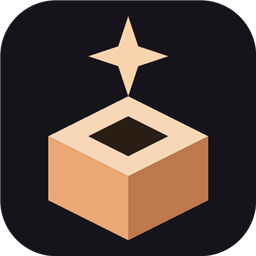
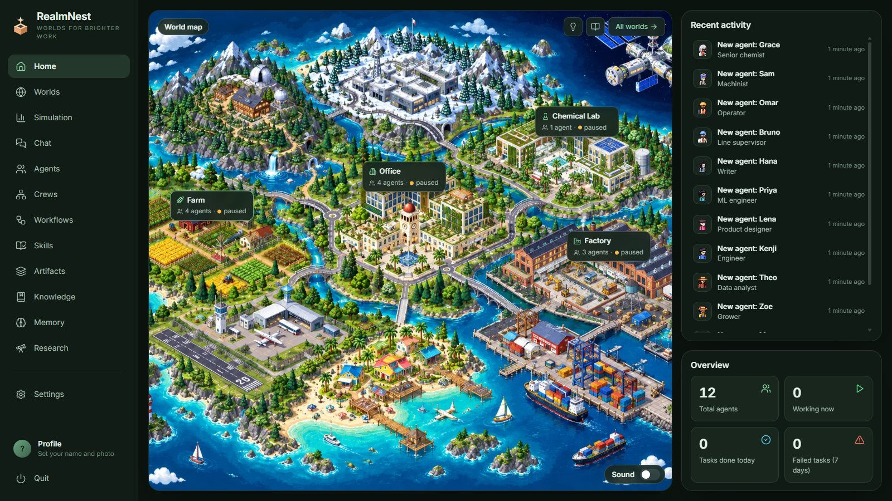
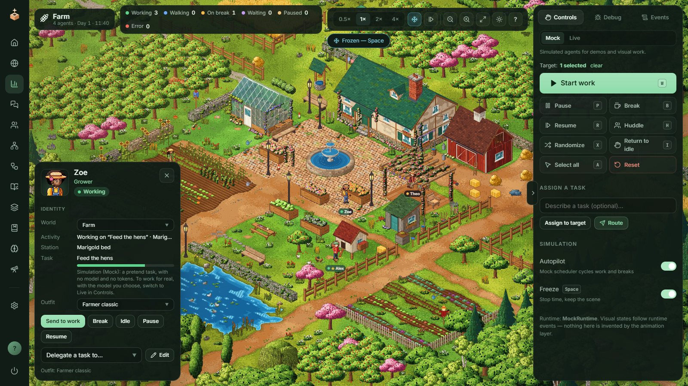
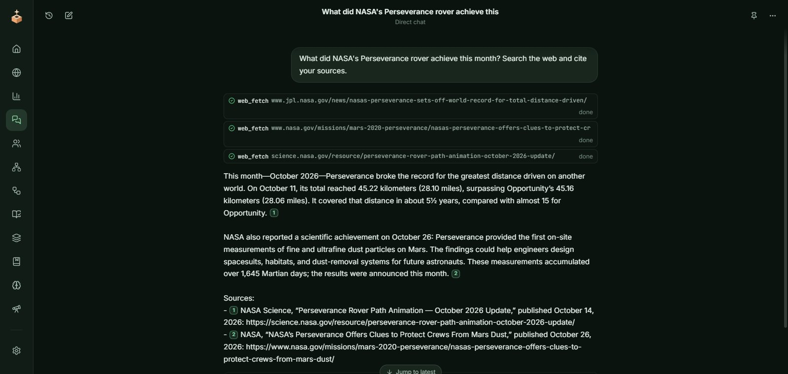
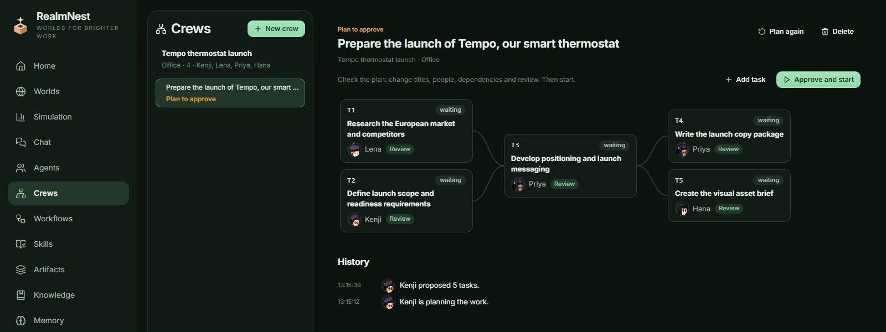
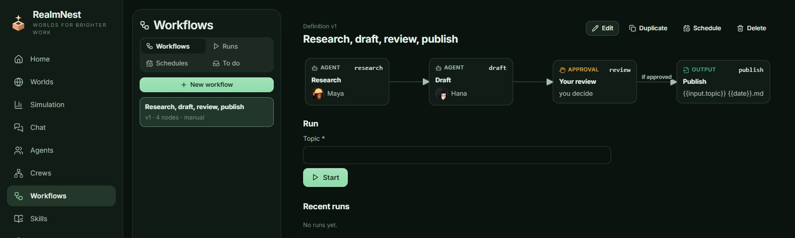
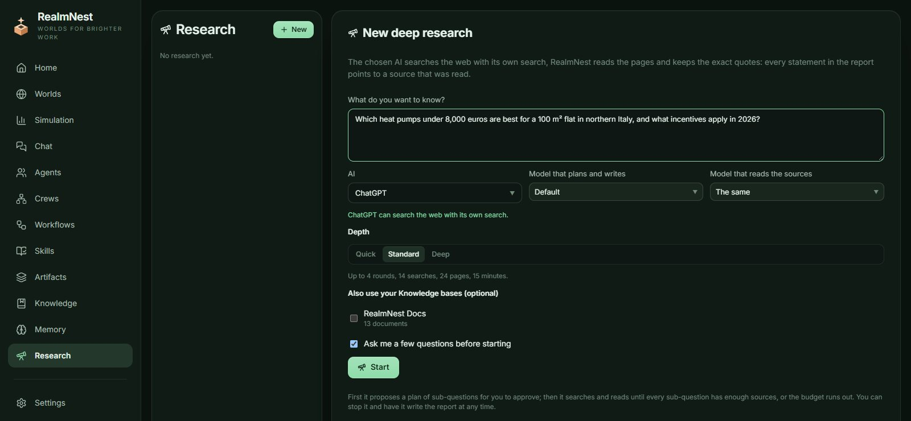
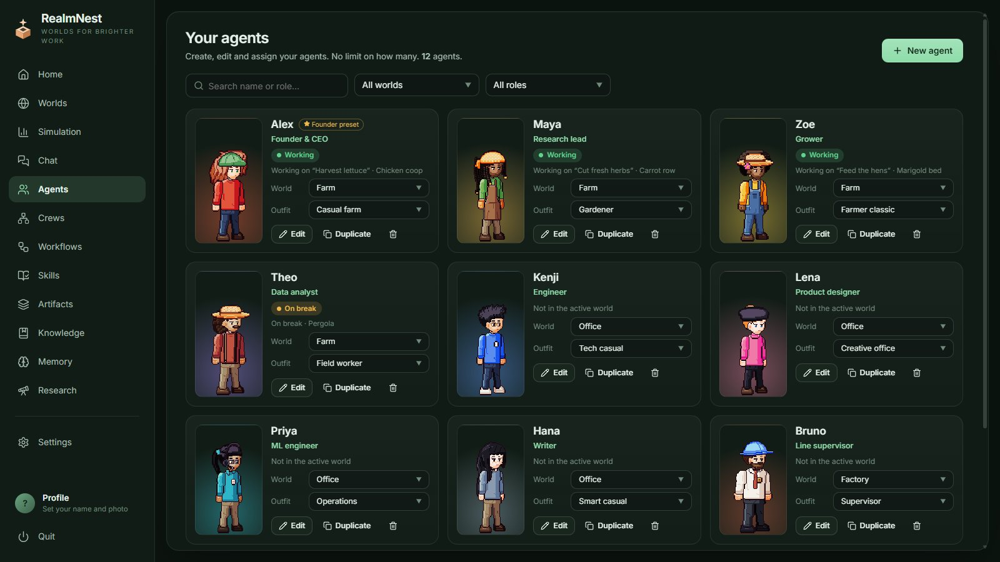
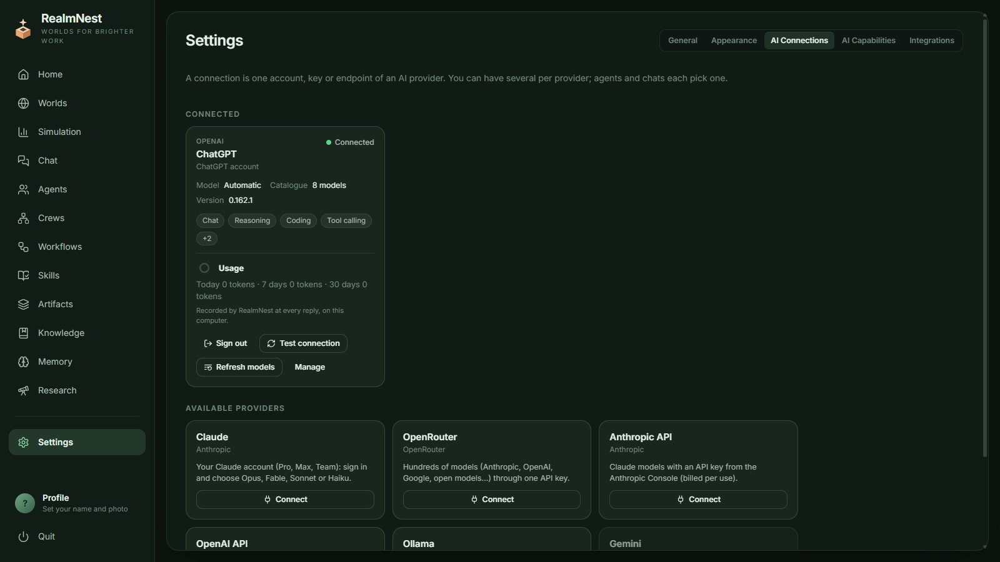
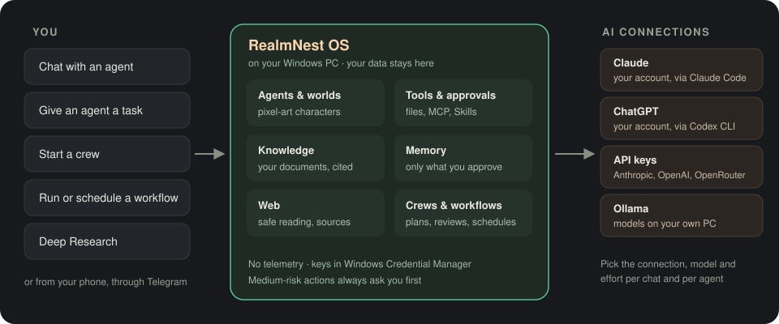

<p align="center">
  
</p>

<h1 align="center">RealmNest OS</h1>

<p align="center">
  <b>Worlds for brighter work.</b><br>
  A visual operating environment for AI agents: build a team, give it real AI models and tools,<br>
  and watch it work as pixel-art characters in hand-made worlds.
</p>

<p align="center">
  
  
  
  
</p>

<p align="center">
  <a href="../../releases/latest"><b>Download for Windows</b></a> ·
  <a href="#what-it-does">Features</a> ·
  <a href="#how-it-works">How it works</a> ·
  <a href="#install">Install</a> ·
  <a href="docs/README.md">Documentation</a>
</p>

<p align="center">
  
</p>

> **Public beta.** RealmNest runs on Windows 10 and 11 only, and you can expect rough edges. Read the [known limitations](docs/HARDENING.md#known-limitations) before you rely on it.

## What is RealmNest OS?

RealmNest looks like a cozy management game, but underneath the agents are real:
- they chat and use tools, with your approval;
- they read your documents and the web, and remember what you allow;
- they work together in crews and run workflows on a schedule.

Each agent is a character with a role, an outfit and a desk in one of ten worlds. When it works on a real task, you see it walk to its station and get busy; when it hands work to a colleague, it walks over to them.

It is a **desktop app that keeps your data on your PC**. You bring your own AI:
- your **Claude** or **ChatGPT** account;
- an API key from **Anthropic**, **OpenAI** or **OpenRouter**;
- models running on your own computer with **Ollama**.

**When to use it**

- **Research a question properly.** Deep Research plans sub-questions, reads real pages and writes a report where every statement points to a source.
- **Run a small team on a goal.** A crew splits the work, a reviewer checks each part, and you approve the plan and the result.
- **Automate the routine.** A workflow can write a weekly report, ask you when something looks off and keep the result as a file.
- **Work with your own documents.** Answers come from your PDFs, Markdown and Word files, with citations that are checked.
- **Keep an eye on things from your phone.** Through Telegram you can talk to agents and approve their actions.

## What it does

<table>
  <tr>
    <td width="50%"></td>
    <td>
      <h3>Worlds and agents</h3>
      <p>Ten hand-made worlds: Office, Factory, Farm, Space Station, Chemical Lab, Creative Studio, Robotics Workshop, Data Center, Research Hub and Port. Create as many agents as you like, dress them and move them between worlds.</p>
      <p>In <b>Mock</b> mode agents act out pretend work. In <b>Live</b> mode an agent runs your task for real, and its character works only while the run goes.</p>
    </td>
  </tr>
  <tr>
    <td>
      <h3>Chat with real AI, on the web</h3>
      <p>Chat with an agent or directly with a model. Conversations persist and remember, and you can attach images and PDFs.</p>
      <p>With <b>Web</b> on, the model can search, and RealmNest reads the pages safely and keeps the sources.</p>
    </td>
    <td width="50%"></td>
  </tr>
  <tr>
    <td width="50%"></td>
    <td>
      <h3>Crews</h3>
      <p>A team of agents in the same world works on one goal. The coordinator proposes a plan with dependencies, and you edit it and approve it.</p>
      <p>Tasks run in order, in parallel when they can, and a reviewer checks each one. The final result waits for your yes.</p>
    </td>
  </tr>
  <tr>
    <td>
      <h3>Workflows</h3>
      <p>Repeatable work in steps: agent tasks, tools, crews, waits, approvals, conditions and parallel branches.</p>
      <p>Run a workflow on demand or on a schedule. What needs you appears in <b>To do</b>.</p>
    </td>
    <td width="50%"></td>
  </tr>
  <tr>
    <td width="50%"></td>
    <td>
      <h3>Deep Research</h3>
      <p>Ask a question and approve the plan. The chosen AI searches the web, RealmNest reads the pages, and the report comes with tables, charts and verified quotes.</p>
      <p>Open the report in your browser, export it to PDF or HTML, or save it to Knowledge.</p>
    </td>
  </tr>
  <tr>
    <td>
      <h3>Your agents</h3>
      <p>Every character has a name, a role, a body, hair and an outfit from its world's collection.</p>
      <p>From the agent's panel you choose its connection and model, its tools, Skills, Knowledge, Memory and Web access.</p>
    </td>
    <td width="50%"></td>
  </tr>
  <tr>
    <td width="50%"></td>
    <td>
      <h3>Bring your own AI</h3>
      <p>Connect Claude with your account (through Claude Code), ChatGPT with your account (through the Codex CLI), API keys for Anthropic, OpenAI and OpenRouter, or Ollama on your own PC.</p>
      <p>You choose the model and the effort level per chat and per agent, and a ring shows how much you are using.</p>
    </td>
  </tr>
</table>

**And also:**
- **Tools with approval:** agents work with files in a folder you choose, and medium-risk actions always ask you first.
- **MCP servers:** local and online servers add tools under the same rules.
- **Skills:** portable instructions that agents follow; they never run code.
- **Knowledge and Memory:**
  - Knowledge indexes your documents (PDF, Markdown, DOCX, CSV, JSON, text), and every citation is checked.
  - Memory keeps only what you approve, separately for each agent.
- **Delegation:** an agent can hand part of its work to a colleague.
- **Telegram:** use RealmNest from your phone, approvals included.
- **Sound:** generated music and world ambience, off by default.
- **Languages:** the interface is in English and Italian.

## How it works

<p align="center">
  
</p>

1. **You give the work.** You can start a chat, give an agent a task, start a crew, run a workflow or start a Deep Research, from the app or from Telegram.
2. **RealmNest runs it on your PC.** It gives the model the agent's role, its Skills, its Knowledge and its Memory.
   - Every tool call goes through RealmNest's permissions, and anything risky waits for your approval.
   - Web pages are read safely and cited.
3. **The AI comes from your connections.** RealmNest has no account and no server of its own: it talks to the provider you chose, with your account or key, and the characters show what is happening.

## Where your data lives

- **Everything stays on this PC:**
  - agents, chats, files, Knowledge, Memory, crews, workflows and settings stay in your Windows user's app folder;
  - API keys and tokens are kept in **Windows Credential Manager**, never in the app's files.
- **No tracking:** there is no telemetry, analytics, crash reporter or update check.
- **What leaves your PC:** only what you send to the AI connections and integrations you set up, such as your prompts to the provider you chose.

The full picture, including how to remove everything, is in [docs/PRIVACY.md](docs/PRIVACY.md).

## Install

1. From the [latest release](../../releases/latest), download `RealmNest-OS_0.12.0_x64-setup.exe` and `SHA256SUMS.txt`, then check the installer with `Get-FileHash RealmNest-OS_0.12.0_x64-setup.exe` (SHA-256).
2. Run it. It installs for your Windows user only, with no administrator rights, and adds RealmNest OS to the Start menu.
   - It is **not code-signed** yet, so Windows SmartScreen may say "Windows protected your PC". Choose *More info › Run anyway* only if the checksum matches.
   - To upgrade, run the new installer over the old version: your data stays.
3. RealmNest needs the Microsoft Edge WebView2 Runtime. Windows 11 and updated Windows 10 already have it, and the installer fetches it if it is missing.

Uninstalling (Settings › Apps) removes the program and keeps your data, unless you tick the box to delete it.

## First steps

RealmNest opens on the Home map with an empty workspace. Create your first agent from **Agents**, or load the demo team from Settings › General › Data to explore. Mock mode needs no account.

To use real AI:

1. **Connect a provider** in Settings › AI connections:
   - **Claude** (your Claude account) needs the [Claude Code](https://claude.com/claude-code) CLI; RealmNest signs you in.
   - **ChatGPT** (your ChatGPT account) needs the [Codex CLI](https://github.com/openai/codex/releases): `codex.exe` on PATH, or `REALMNEST_CODEX_PATH` set to its file or folder.
   - **Anthropic API**, **OpenAI API** and **OpenRouter** need an API key, which is stored in Windows Credential Manager.
   - **Ollama** needs [Ollama](https://ollama.com) installed and a model pulled. RealmNest starts it when needed and stops it when RealmNest closes.
2. **Chat:** pick the connection and model next to the composer, turn **Web** on if you like, and write.
3. **Give a task:** open **Simulation › Controls › Live**, select an agent in the world and give it a task.
4. **Optional:**
   - Settings › General › Tools for the work folder;
   - Settings › Integrations for MCP servers and Telegram.

You can back up your data at any time from **Settings › General › Data › Export a backup**.

## Build from source

Requirements:
- Windows 10/11;
- Node.js 18+;
- Rust (stable, MSVC toolchain) with the Visual Studio C++ build tools;
- WebView2.

See [docs/TAURI.md](docs/TAURI.md) for details.

```bash
npm ci
npm run dev                              # browser build at http://localhost:5173 (Mock mode, no native features)
npm run tauri dev                        # desktop app in development
npm run typecheck && npm test            # TypeScript + Vitest
cd src-tauri && cargo test && cargo clippy --all-targets -- -D warnings
npm run tauri build -- --bundles nsis    # release exe + Windows installer
```

## Documentation

The feature and architecture docs are in [docs/](docs/README.md). They cover:
- the runtime, chat, connections and providers;
- capabilities and routing;
- tools, MCP, Skills and files;
- Knowledge, Memory, the web and Deep Research;
- delegation, crews and workflows;
- Telegram, audio and the UI.

For the state of the release, see [docs/STATUS.md](docs/STATUS.md), [docs/HARDENING.md](docs/HARDENING.md) and [CHANGELOG.md](CHANGELOG.md).

<details>
<summary><b>Project layout</b></summary>

| path | what |
| --- | --- |
| `src/` | the app (TypeScript, React): `ui/` screens; `runtime/` agents, chat, tools, MCP, Skills, Knowledge, Memory, web, crews, workflows and Telegram; `render/` and `engine/` the worlds; `tests/` Vitest |
| `src-tauri/` | the native side (Rust, Tauri 2): process host for the CLIs, provider HTTP hosts, files, secrets, MCP, web reader and Telegram |
| `public/` | the baked world pictures and the Home map |
| `tools/` | the character pipeline (`charpipe`, partly used by the app), world bake helpers and release scripts |
| `examples/skills/` | sample Skills |
| `docs/` | documentation; `docs/images/` holds the pictures on this page |

</details>

## Security

To report a vulnerability, follow [SECURITY.md](SECURITY.md).

## Contributing

See [CONTRIBUTING.md](CONTRIBUTING.md).

## License

Copyright (C) 2026 Marius Alexandru Pisaru.

RealmNest OS is free software: you can redistribute it and/or modify it under the terms of the GNU Affero General Public License as published by the Free Software Foundation, either version 3 of the License, or (at your option) any later version. It is distributed in the hope that it will be useful, but WITHOUT ANY WARRANTY; see [LICENSE](LICENSE).

The licences of third-party components are in [THIRD_PARTY_NOTICES.md](THIRD_PARTY_NOTICES.md), and art and other assets are described in [ASSETS.md](ASSETS.md). Formerly called Nestra ([docs/REBRAND.md](docs/REBRAND.md)).
